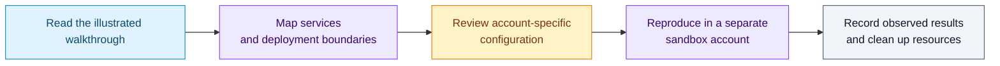

# AWS Cloud DevSecOps — implementation notes

An illustrated AWS learning project covering **IAM permissions, environment-tagged EC2 access, and S3 static website hosting**. The primary deliverable is [AWS Cloud DevSecOps — Part 1](AWS%20Cloud%20DevSecOps%20%5BPart1%5D.pdf), an illustrated walkthrough retained in this repository.

## How to use the material

## What the report demonstrates

- Restricting EC2 start/stop access using environment tags, then observing allowed development access and denied production access.
- Group-based IAM permissions and an account-alias exercise.
- Uploading a static site to S3, diagnosing an initial 403 response, and reviewing object/bucket access.

These are historical console exercises. The report does not demonstrate a seven-service CI/CD pipeline. Public object access in a training walkthrough is an environment-specific choice, not a general storage-security recommendation.

## Repository scope

This checkout contains the PDF, this README, and the [license](LICENSE). It does not contain an application, infrastructure-as-code modules, a reusable CI workflow, or credentials. The document is evidence of the exercise; it is not a deployable stack.

Start by identifying the services and permissions described in the report, then translate them into your own sandbox configuration. Service names, console screens, quotas, and costs may differ from the historical walkthrough. Review those details before provisioning resources.

For a portfolio, use an attributed excerpt of the existing report rather than presenting an unrelated running application as this project's interface.
